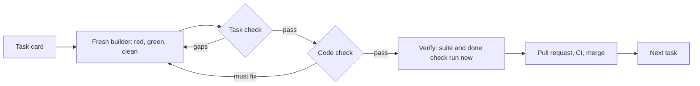

# Design

Version 0.3, 2026-11-26.

## Goal

One repeatable way to take any product from an idea to a running product that stays up, so
that every product is planned, designed, built, tested, deployed and operated to the same
standard, and the owner stays in control at every step.

The first user is the owner, building TechNaom products. Anyone else can use it as is.

## How it works

Idea to Orbit is a Claude Code plugin:

- **Seven stage skills**, one per stage, in `skills/<stage>/SKILL.md`. Each says what the
  stage needs as input, what it does, what it writes, its red flags and what its gate checks.
- **Three helper skills** that every stage uses: `review`, `debug` and `verify`.
- **Templates** for every document a stage writes, in `skills/<stage>/templates/`, and
  **briefs** for the fresh agents that build and check work: `skills/build/builder-brief.md`
  and `skills/review/*-check.md`.
- **One command**, `/orbit`, in `commands/orbit.md`. It reads the product's state and starts
  or continues the right stage.
- **One hook**, at session start, in `hooks/`. It reads the product's state and puts the
  stage and the session rules in front of Claude before the first message.

All output goes into the product's own repository under `docs/orbit/`, so the plan, the
decisions and the history travel with the code.

## Holding the line

Written rules only help if they are followed when it is inconvenient. Four things work
together so they are:

1. **The session-start hook.** Claude learns the stage and the rules at the start of every
   session, after `/clear` and after a context compaction, without being asked.
2. **Iron rules.** Each one is short and has no exceptions written in: no production code
   without a failing test first; no fix without a known cause; no claim without fresh
   evidence; no gate without an explicit yes. When the owner chooses to skip one, Claude
   says what it protects, follows the decision and records it.
3. **Red flags.** Every skill lists the thoughts that come just before a shortcut ("it's a
   one-line change", "the agent said the tests pass") with what to do instead. Naming the
   thought makes it easier to catch.
4. **Fresh eyes.** The agent that writes a change never approves it. Each task gets a task
   check and a code check from fresh agents with no memory of the work, and each milestone
   gets a branch check.

## Build in detail

Tasks with no dependency on each other and no shared files can run in parallel, each in its
own git worktree, up to three at a time. They still merge one at a time, with the suite run
again after each merge.

## State

`docs/orbit/STATE.md` is the single source of truth for where a product is:

- the current stage and its status (`in progress`, `waiting for approval`, `approved`,
  `needs review`)
- each gate's approval: who said yes and when
- open questions that block a stage
- a dated log of stage changes and of every rule the owner chose to skip

A stage may start only when the stage before it is `approved`. The owner can send a product
back to an earlier stage at any time; later stages are then marked `needs review`.

## Gates

Every stage ends with a gate:

1. Claude checks the stage's exit list (in its skill), with evidence for each item.
2. Claude shows the owner a short summary: what was made, what was decided, what is open.
3. The owner answers. Only an explicit yes ("approved", "go", "yes, proceed") passes the gate.
   Anything else is feedback, and the stage continues.
4. Claude records the approval in `STATE.md` with the date.

## The stages

| Stage | Input | Output | Gate checks |
|---|---|---|---|
| Ignite | The idea, in any form | brief, PRD | Problem, users, scope and success measures are clear; out of scope is written down |
| Blueprint | Approved PRD | architecture, ADRs, diagrams | At least two options weighed for each big decision; data model, interfaces, security, cost and failure modes covered |
| Assemble | Approved architecture | tasks, task cards, issues | Every requirement maps to tasks; every task has a test, a done check and a card with files, steps and commands |
| Build | Approved tasks | code, tests | Each task: test seen failing first, task check and code check passed, verified, merged; a branch check per milestone |
| Test flight | Built product | release gate result | Tests green, risks listed, secrets safe, cost estimated, rollback rehearsed |
| Launch | Passed release gate | deploy plan, live product | Budget cap and alerts set first, backup tag taken, smoke test passes on the live product |
| Orbit | Live product | runbook, incident records | Health check on its own clock, alerts reach the owner, healing has limits, every incident gets a root cause |

## Testing the plugin

- `tests/check.py` runs offline, with no model calls, on every push: JSON files, versions,
  skill frontmatter and sections, links, the eval suite's shape, and the session-start hook
  against a sample product and an empty folder.
- `evals/` holds pressure scenarios for `claude plugin eval`: each puts Claude under a
  realistic push to break a rule (a demo in 15 minutes, a one-line typo, "looks great, but")
  and a judge checks it held. They cost model calls, so they run by hand. See
  [Testing](testing.md).

## Defaults

These hold unless the owner chooses otherwise for a product:

- Serverless hosting that scales to zero, on the free tier where possible.
- A monthly spending cap with alerts at 25, 50, 80 and 100 percent, set before the first
  deploy.
- Secrets in a gitignored `.env`, with a committed `.env.example`.
- GitHub for code, CI, issues and alerts.
- Diagrams in Mermaid, so they render on GitHub with nothing to install.

## Next

- Build one real product end to end with the plugin and record the time, cost, test count
  and number of fixes after launch. This is the test that matters most.
- Publish eval results for each release: pass rate with the plugin and without it.
- A product dashboard that reads every product's `STATE.md`.
- Ready-made deploy templates for the common targets (AWS Lambda with EventBridge,
  Cloudflare Workers, Cloud Run).
