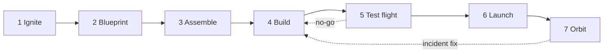

# Concepts

Nine ideas explain how Idea to Orbit behaves.

## Stages

A product moves through seven stages, always in this order:

Each stage has one job, and writes its results as files:

| Stage | Its one job |
|---|---|
| Ignite | Agree what to build and why |
| Blueprint | Decide how it is built |
| Assemble | Break the work into small, tested tasks |
| Build | Build each task, test first |
| Test flight | Decide go or no-go, with evidence |
| Launch | Put it live, within budget, with a way back |
| Orbit | Keep it running, and learn from every failure |

## Gates

Every stage ends at a gate. Claude checks the stage's exit list, shows you a short summary,
and waits. The next stage starts only after an explicit yes from you: "approved", "go",
"yes, proceed". A question, a comment or silence is not a yes.

Gates exist because the cheapest moment to catch a wrong idea is while it is still one
paragraph in a brief, not a thousand lines of code or a bill.

## Rules that hold

Four rules hold in every stage: no production code without a failing test first, no fix
without a known cause, no claim without fresh evidence, and no gate without your yes.

Three things keep them from slipping when a session gets long or a deadline gets close:

- **A session-start hook** reads `STATE.md` and tells Claude the stage and the rules at the
  start of every session, and again after `/clear` or a context compaction.
- **Red flags** in every skill name the thoughts that come just before a shortcut, with what
  to do instead.
- **Fresh eyes:** the agent that writes a change never approves it. A task check and a code
  check by fresh agents come before every merge.

You stay in charge: if you choose to skip a rule, Claude says what it protects, does what
you decide, and writes the decision in the log.

## The state file

`docs/orbit/STATE.md`, in your product's repository, records:

- the current stage and its status
- every gate: whether it passed, and when
- open questions, and which stage each one blocks
- a dated log of what happened

It is plain Markdown. You can read it, edit it and commit it like any other file. `/orbit`
reads it to know what to do next, so you can stop at any point and come back days later.

Statuses:

| Status | Meaning |
|---|---|
| not started | The stage has not begun |
| in progress | Claude is working on it |
| waiting for approval | The exit list is met; your yes is needed |
| approved | You approved it; the next stage may start |
| needs review | An earlier stage changed, so this one must be checked again |

## Settings

`STATE.md` also holds the product's Settings: the code host (GitHub or GitLab), the work branch
and release branch, how releases promote (for example `dev`, then staging, then prod after a
manual approval), who builds (Claude's subagents, or an outside agent such as Cursor or Kiro
through a launcher), the fast tests, and the full suite with how long it takes. Every stage
reads them, so nothing assumes GitHub, `main` or a quick suite.

## Profiles

A product has one of two profiles, set in Ignite:

| | startup | enterprise |
|---|---|---|
| Hosting | Scales to zero, free tier | Scales to zero where it can; managed databases and private networks where the data needs them |
| Secrets | `.env` on your laptop, the secret store in CI and production | A managed secret store everywhere |
| Compliance | Note any law that applies | A control mapping, data classification, audit log, no personal data in logs |
| Release | `main` deploys | A work branch, then staging, then prod after approval |

## Lanes

Once a product is past Build, new work runs in a lane instead of moving the whole product back
a stage:

| Lane | For | In short |
|---|---|---|
| Feature | New behaviour | A short ignite for the feature, cards, build, the release lines it touches |
| Fix | A bug, not urgent | Find the cause, a failing test, the build loop |
| Hotfix | Users affected now | Roll back first, then the fix lane, then a root cause analysis |

Each lane is listed under **In flight** in `STATE.md` until it is merged. Several can run at
once when they change different files.

## The journal

`docs/orbit/JOURNAL.md` records every change, every fix made in review, and every roadblock:
what went wrong, its cause, how it was cleared, and the lesson. The learn skill reads it at
the end of each milestone and turns repeated trouble into checks.

## The workspace

Everything the stages write lives in your product's repository under `docs/orbit/`, next to
the code. The plan, the decisions and the history travel with the product, show up in pull
requests, and are there for the next session, human or AI.

## Traceability

Requirements get IDs in Ignite (R1, R2 ... and N1, N2 ... for non-functional ones). Every
later stage refers to them: architecture parts, tasks, tests and the release gate. So at
any point you can ask "which requirement is this for?" and "is every requirement covered?",
and get an answer from the files.

## Defaults

For the startup profile, unless you choose otherwise:

- a spending cap and alerts are set before anything is deployed
- hosting scales to zero, so an idle product costs nothing
- every product is its own silo: own keys, data, quotas and alerts
- secrets live in a gitignored `.env`, with a committed `.env.example`
- a backup tag is taken before every release
- a green run that delivered nothing counts as a failure
