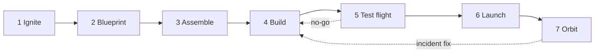

# Concepts

Five ideas explain how Idea to Orbit behaves.

## Stages

A product moves through seven stages, always in this order:

Each stage has one job, and writes its results as files:

| Stage | Its one job |
|---|---|
| Ignite | Agree what to build and why |
| Blueprint | Decide how it is built |
| Assemble | Break the work into small, tested tasks |
| Build | Build each task, test first |
| Test flight | Decide go or no-go, with evidence |
| Launch | Put it live, within budget, with a way back |
| Orbit | Keep it running, and learn from every failure |

## Gates

Every stage ends at a gate. Claude checks the stage's exit list, shows you a short summary,
and waits. The next stage starts only after an explicit yes from you: "approved", "go",
"yes, proceed". A question, a comment or silence is not a yes.

Gates exist because the cheapest moment to catch a wrong idea is while it is still one
paragraph in a brief, not a thousand lines of code or a bill.

## The state file

`docs/orbit/STATE.md`, in your product's repository, records:

- the current stage and its status
- every gate: whether it passed, and when
- open questions, and which stage each one blocks
- a dated log of what happened

It is plain Markdown. You can read it, edit it and commit it like any other file. `/orbit`
reads it to know what to do next, so you can stop at any point and come back days later.

Statuses:

| Status | Meaning |
|---|---|
| not started | The stage has not begun |
| in progress | Claude is working on it |
| waiting for approval | The exit list is met; your yes is needed |
| approved | You approved it; the next stage may start |
| needs review | An earlier stage changed, so this one must be checked again |

## The workspace

Everything the stages write lives in your product's repository under `docs/orbit/`, next to
the code. The plan, the decisions and the history travel with the product, show up in pull
requests, and are there for the next session, human or AI.

## Traceability

Requirements get IDs in Ignite (R1, R2 ... and N1, N2 ... for non-functional ones). Every
later stage refers to them: architecture parts, tasks, tests and the release gate. So at
any point you can ask "which requirement is this for?" and "is every requirement covered?",
and get an answer from the files.

## Defaults

Unless you choose otherwise for a product:

- a spending cap and alerts are set before anything is deployed
- hosting scales to zero, so an idle product costs nothing
- every product is its own silo: own keys, data, quotas and alerts
- secrets live in a gitignored `.env`, with a committed `.env.example`
- a backup tag is taken before every release
- a green run that delivered nothing counts as a failure
