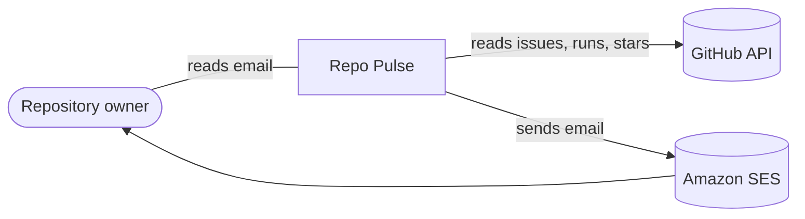
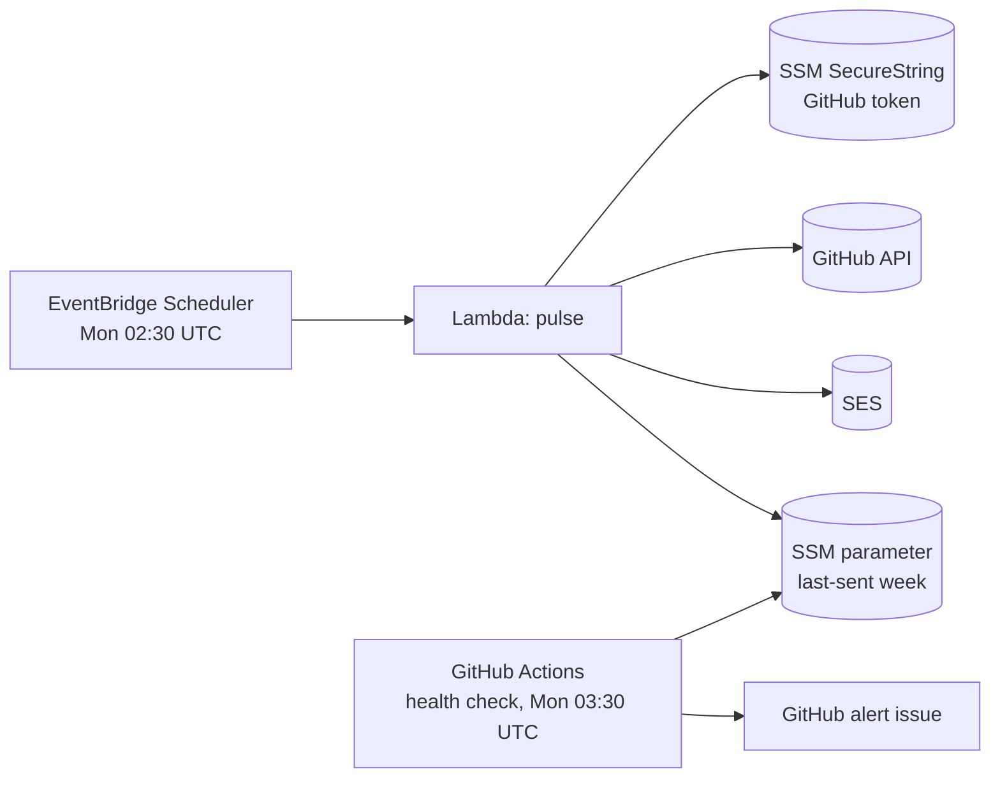
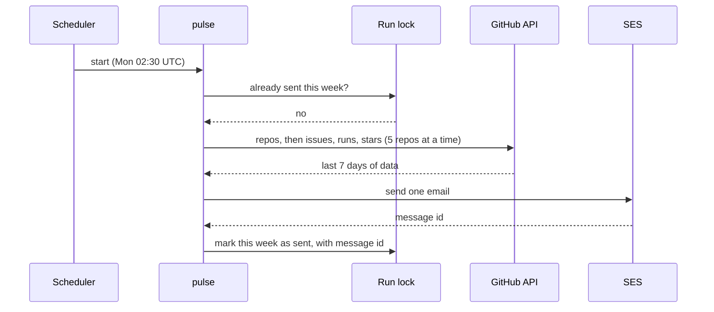

# Architecture: Repo Pulse

Version 1, 2026-11-24. PRD: [prd.md](prd.md). Decisions: [adr/](adr/)

## Summary
Once a week a scheduler starts one Lambda function. It reads the last 7 days of issues, CI
runs and stars for every repository from the GitHub API, builds one email and sends it with
Amazon SES. Nothing runs between Mondays, and there is no database: "new" always means
"in the last 7 days", which the GitHub API can answer directly. A separate health check, on
a different clock, confirms the email was sent.

## Context

## Containers

| Container | Responsibility | Technology | Scales to zero? |
|---|---|---|---|
| Scheduler | Start the run every Monday 08:00 IST | EventBridge Scheduler | Yes |
| pulse | Collect, build and send the email | Lambda, Python 3.12, 256 MB, 120 s timeout, concurrency 1 | Yes |
| Token store | Hold the read-only GitHub token, encrypted | SSM Parameter Store, SecureString | n/a |
| Run lock | Record the week already sent, so a second run sends nothing | SSM Parameter Store | n/a |
| Health check | Confirm this Monday's email was sent; alert if not | GitHub Actions schedule | Yes |

## Key flows

### Monday run

### Failure path: the GitHub API fails
1. A call returns an error or times out.
2. The function waits 30 seconds and retries the whole collection once.
3. If it fails again, it sends nothing (no half-empty email), logs the error, and exits with
   a failure.
4. At 09:00 IST the health check finds no "sent" record for this week and opens an alert
   issue with the last error line.

## Data model

| Entity | Fields | Relationships | Owner |
|---|---|---|---|
| RepoNews (in memory) | repo, new_issues[], failed_runs[], new_stars | One per repository | pulse |
| Run lock | week (ISO week), sent_at, message_id | One value | pulse |

Nothing is stored between runs except the run lock.

## Interfaces

| Interface | Type | Contract | Consumers |
|---|---|---|---|
| GitHub REST API | HTTPS | `/user/repos`; `/repos/{r}/issues?since=`; `/repos/{r}/actions/runs?branch=&status=failure`; `/repos/{r}/stargazers` with star times | pulse |
| SES SendEmail | AWS API | From a verified sender to one recipient; plain text and HTML | pulse |
| Run lock | SSM parameter `/repo-pulse/last-sent` | JSON with week, sent_at, message_id | pulse, health check |

## Security
- Secrets: a fine-grained GitHub token, read-only for metadata, issues and actions, in
  SSM Parameter Store as an encrypted SecureString. CI deploy credentials live in GitHub secrets. Nothing secret in the
  repository.
- Auth: the Lambda's role can read only its secret and its parameter, and send email only
  from the verified sender.
- Data: issue titles from the owner's own repositories; nothing stored after the run.

## Cost

| Part | Expected monthly cost | Free tier used |
|---|---|---|
| Lambda | $0.00 | 4-5 runs of about 40 s |
| EventBridge Scheduler | $0.00 | 5 invocations |
| SES | $0.00 | 5 emails |
| SSM Parameter Store | $0.00 | 2 standard parameters (token, run lock) |
| **Total** | **$0.00** | |

Spending cap: $2 per month, alerts at 25/50/80/100% and forecast.

## Failure modes

| Failure | Detection | Recovery |
|---|---|---|
| GitHub API error or rate limit | Function exits with failure; health check finds no "sent" | One retry inside the run; then an alert issue |
| Token expired or revoked | 401 from GitHub; health check alert | Owner rotates the token (runbook) |
| SES rejects the email | Error on send; health check alert | Check SES sending status; resend by hand |
| Scheduler disabled or deleted | Health check finds no run at all | Re-run the deploy workflow |
| Two runs at once | Run lock already set | Second run exits without sending |

## Traceability

| Requirement | Satisfied by |
|---|---|
| R1, R2, R3 | pulse: collectors for issues, runs, stars |
| R4, R5 | Scheduler; pulse: email builder |
| N1 | Free-tier services; AWS budget |
| N2 | Parallel collection, 5 repositories at a time |
| N3 | Encrypted SSM parameter; least-privilege role |
| N4 | Run lock; health check on its own clock |
