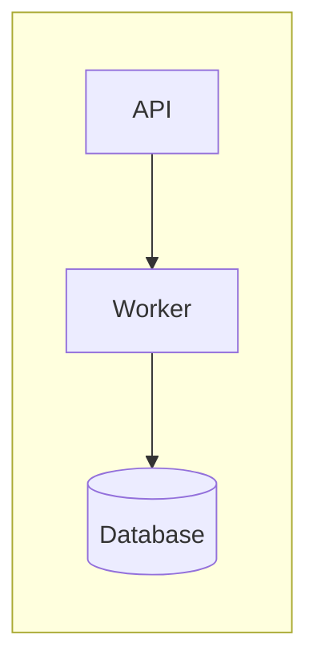
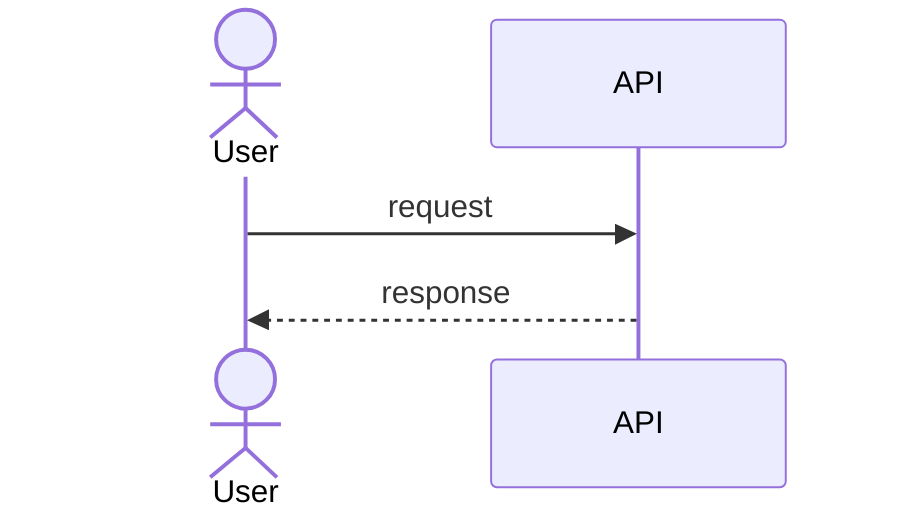

# Architecture: <product name>

Version <n>, <YYYY-MM-DD>. PRD: [prd.md](prd.md). Decisions: [adr/](adr/)

## Summary
<Three to five lines: what the parts are and how a request flows through them.>

## Context

## Containers

| Container | Responsibility | Technology | Scales to zero? |
|---|---|---|---|

## Key flows

### <Flow name>

### <Failure path>
<What happens when <part> fails, step by step.>

## Data model

| Entity | Fields | Relationships | Owner |
|---|---|---|---|

## Interfaces

| Interface | Type | Contract | Consumers |
|---|---|---|---|
| Observability for tests | <attributes, status endpoint, test-mode flag> | <the state a test can read, and how a test pins what the product changes on its own> | Tests |

## Security
- Secrets: <where they live, who can read them>
- Auth: <how users and services prove who they are>
- Data: <what is sensitive, how it is protected>

## AI

Delete this section if the product calls no model.

| Job | Model | Why (ADR) | Cost per call | Monthly at expected load |
|---|---|---|---|---|

- Never decided by the model: <ratings, approvals, prices ...>
- Checks in code on every output: <numbers against the source, citations resolve, banned phrases>
- When a check fails, the user sees: <the template text, a "withheld" note ...>
- Evals: <cases>, judge <model>, bars: <figures 1.00, groundedness 0.95> (requirements <N..>)
- Metering and budget: <per call, per tenant per day, what happens at the cap>

## Screens

Delete this section if the product has no UI.

| Screen | Route | Heading | Roles that open it | Roles refused | Key controls |
|---|---|---|---|---|---|

**Visual system:** the colour and spacing tokens, the layers in z-order (what sits above what),
and what changes per state (for example what turns see-through when a background effect runs,
and what every fallback looks like).

Mockup: <link>. Browser tests load this list (or `<path>/screens.yaml`).

## Compliance

For the enterprise profile; otherwise one line on any law that applies.

| Control area | How the design meets it | Where |
|---|---|---|

## Cost

| Part | Expected monthly cost | Free tier used |
|---|---|---|
| **Total** | | |

Spending cap: <amount per month>, alerts at 25/50/80/100%.

## Failure modes

| Failure | Detection | Recovery |
|---|---|---|

## Traceability

| Requirement | Satisfied by |
|---|---|
| R1 | |
