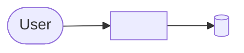
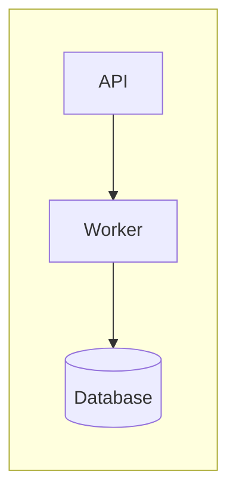
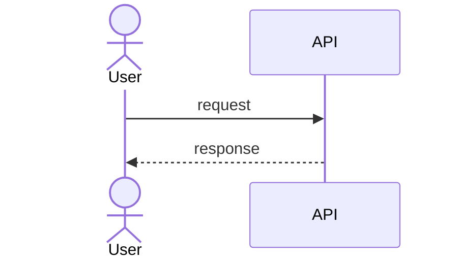

# Architecture: <product name>

Version <n>, <YYYY-MM-DD>. PRD: [prd.md](prd.md). Decisions: [adr/](adr/)

## Summary
<Three to five lines: what the parts are and how a request flows through them.>

## Context

## Containers

| Container | Responsibility | Technology | Scales to zero? |
|---|---|---|---|

## Key flows

### <Flow name>

### <Failure path>
<What happens when <part> fails, step by step.>

## Data model

| Entity | Fields | Relationships | Owner |
|---|---|---|---|

## Interfaces

| Interface | Type | Contract | Consumers |
|---|---|---|---|

## Security
- Secrets: <where they live, who can read them>
- Auth: <how users and services prove who they are>
- Data: <what is sensitive, how it is protected>

## Cost

| Part | Expected monthly cost | Free tier used |
|---|---|---|
| **Total** | | |

Spending cap: <amount per month>, alerts at 25/50/80/100%.

## Failure modes

| Failure | Detection | Recovery |
|---|---|---|

## Traceability

| Requirement | Satisfied by |
|---|---|
| R1 | |
